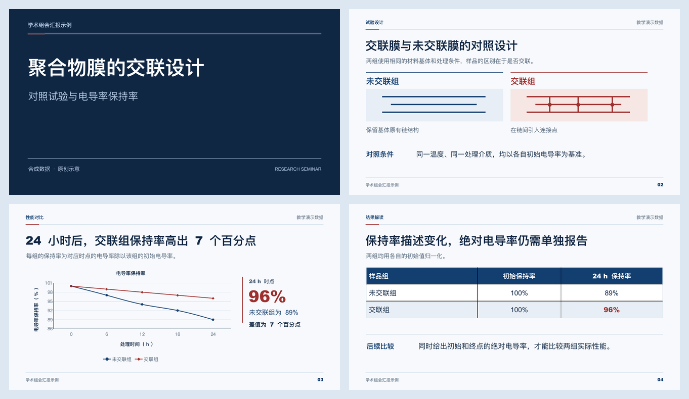

# 学术报告 PPT 技能套件

从论文 PDF 和汇报要求出发，在 Codex 中制作带逐页备注的可编辑 PowerPoint。也可以在已有汇报中替换一篇论文、补齐原图，或只改指定几页的版式。新稿默认先用 ImageGen 做成一页一张的整页设计预览，再用可编辑对象重建并渲染检查。

| 你有的材料 | 使用的技能 | 用途 |
| --- | --- | --- |
| 论文 PDF、一份要修改的 PPTX，或两者都有 | [论文汇报](skills/artifact-template-academic-paper-report/SKILL.md) | 提取原图、组织内容、换入研究章节、检查子图和逐字稿 |
| 想直接使用国自然答辩模板 | [国自然科研答辩模板库](skills/nsfc-ppt-component-library/SKILL.md) | 完整 39 页脱敏模板、8 页速用组件和色卡，可与论文汇报技能一起使用 |

## 看成品

**国自然答辩**：[完整 39 页可编辑脱敏模板](skills/nsfc-ppt-component-library/assets/nsfc-reference-full.pptx) · [39 页 PDF 预览](skills/nsfc-ppt-component-library/assets/nsfc-reference-full.pdf) · [8 页速用组件](skills/nsfc-ppt-component-library/assets/components-candidate.pptx)

**学术组会**：[8 页可编辑示例](examples/membrane-demo/report.pptx) · [示例 PDF](examples/membrane-demo/report.pdf) · [配套讲稿](examples/membrane-demo/README.md)



完整国自然模板沿用 39 页原稿的页序和主要版式。原项目题目、个人与机构信息、原有图像和数据等敏感内容已替换为通用占位。需要快速挑页时，也可使用 [8 页速用组件预览](skills/nsfc-ppt-component-library/assets/components-reference.pdf)。

公开组会示例按最终双论文组会稿的封面、红蓝目录、三栏问题页、策略表、图证页、对照、总结和致谢重建。数据为合成教学数据，标识是演示占位。

说“直接用国自然答辩模板”时，优先使用你提供的原稿。缺少原稿时，使用仓库的 39 页脱敏模板。普通论文组会沿用组会示例。样式分别见[组会成品锚点](skills/artifact-template-academic-paper-report/references/final-report-style.md)和[国自然组件锚点](skills/nsfc-ppt-component-library/references/components.md)。

## 安装

在 Codex 对话中发送：

> 用 $skill-installer 从 mathliuyang/academic-ppt-skill-kit 安装 skills/artifact-template-academic-paper-report 和 skills/nsfc-ppt-component-library。

也可以在终端运行：

```sh
python3 "${CODEX_HOME:-$HOME/.codex}/skills/.system/skill-installer/scripts/install-skill-from-github.py" \
  --repo mathliuyang/academic-ppt-skill-kit \
  --path skills/artifact-template-academic-paper-report skills/nsfc-ppt-component-library
```

手动安装时，下载仓库，把所需的整个技能文件夹复制到 Codex 用户技能目录，默认是 `~/.codex/skills/`。已有同名目录时，安装器会停止，先保留个人版本再决定是否替换。安装后在新对话中使用。

## 直接这样说

**上传论文 PDF**

> 用 $artifact-template-academic-paper-report 做一份 20 分钟中文组会 PPT，面向材料专业研究生。沿用最终组会稿的蓝白红版式，先用 ImageGen 出每页完整设计，再做成可编辑稿。保留论文原图，关键结果用可编辑中文标注，提供 PPTX、预览 PDF、Word 和大字讲稿 PDF。

**在旧报告里换论文**

> 以上传的 PPTX 为底稿另存，把第二篇研究替换成我上传的论文。保留第一篇，更新和新论文有关的背景、目录、过渡、比较及备注。论文正文子图全部覆盖，补充材料如未取得请单独说明。

**只改局部**

> 只重排第 4、7 页，保留原文和备注，参照第 5 页的配色。统一全篇可见页码，再给我 PPTX 和同版 PDF。

## 新稿制作顺序

1. 读 PDF 并核对每页的标题、主图、数据和讲述顺序。
2. 用选定模板作参考，让 ImageGen 生成每一页的完整设计稿，核对整套预览。
3. 按设计稿程序化重建原生文本、图表、表格、图注和标注，放回真实论文原图。
4. 实际渲染对照设计稿，核对页码和逐页讲稿。交付整套预览、可编辑 PPTX 及配套文件。

## 运行环境与检查

技能由 Codex 编排，输入论文和要求后，根据当前可用的演示工具制作可编辑 PPTX。同版 PDF 需要演示渲染器或本机 LibreOffice。独立讲稿生成与检查可使用自带 Python 脚本，依赖见 [requirements.txt](requirements.txt)。生成讲稿 PDF 时选用本机可用的常规与粗体中文字体，按[讲稿说明](skills/artifact-template-academic-paper-report/references/speech-data.md)传入。模板、PPTX 及 PDF 示例可以直接下载查看。

[增删论文与局部改版说明](skills/artifact-template-academic-paper-report/references/revise-existing-deck.md)含子图清单示例和检查命令。真实论文或学校素材由使用者按自己的用途提供。公开展示示例使用原创页面和演示数据。
